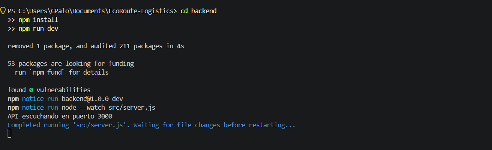

# EcoRoute-Logistics
SaaS para optimizar las rutas de entrega de flotas pequeñas (menos de 15 vehículos). Incluye panel del administrador, portal del conductor y cálculo de CO₂ ahorrado. React, Node.js/Express y PostgreSQL con PostGIS, desplegado en AWS.

Documentación de AWS: [docs/aws.md](docs/aws.md)

## Requisitos previos
- **Node.js** (versión LTS recomendada, por ejemplo v20+ o v22+) y `npm`.
- **PostgreSQL** con extensión **PostGIS** habilitada para el manejo geográfico de rutas y paradas.
- **Git** para clonar el repositorio y gestionar ramas/entregas.

## Variables de entorno
Configura las variables necesarias antes de iniciar el backend y el frontend (usa un archivo `.env` local y no subas credenciales reales al repositorio):

- **Backend (`backend/.env`):**
  - `PORT`: puerto del servidor Express (por ejemplo, `3000`).
  - `DATABASE_URL` o parámetros de conexión (`PGHOST`, `PGPORT`, `PGDATABASE`, `PGUSER`, `PGPASSWORD`): conexión a PostgreSQL/PostGIS.
  - `JWT_SECRET`: clave secreta para firmar y validar tokens de autenticación.
- **Frontend:**
  - `VITE_API_URL` o variable base de la API según la configuración del cliente React para apuntar al backend.

## Getting Started (entorno local)
1. **Clonar el repositorio:**
   ```bash
   git clone [https://github.com/EcoRoute-Logistics/EcoRoute-Logistics.git](https://github.com/EcoRoute-Logistics/EcoRoute-Logistics.git)
   cd EcoRoute-Logistics

### Entorno local en ejecución
- **Frontend (Next.js):**
  
- **Backend (API Express):**
  

## Estructura del proyecto
```text
EcoRoute-Logistics/
├── backend/
│   └── src/
│       ├── controllers/   # Controladores HTTP de la API
│       ├── services/      # Lógica de negocio, cálculo/persistencia de rutas y CO₂
│       ├── routes/        # Rutas y endpoints del servidor Express
│       └── server.js      # Punto de entrada del backend
├── frontend/              # Aplicación web en Next.js (panel de admin y portal del conductor)
├── docs/
│   ├── aws.md             # Documentación de infraestructura y despliegue en AWS
│   └── capturas/          # Capturas de referencia del entorno local
└── README.md


## Flujo del sistema
```text
[Datos y pedidos] ---> [Backend (API / Lógica / PostGIS)] ---> [Frontend (Next.js)]
                             |
                             +---> Persistencia de rutas, paradas y estados
                             +---> Estimación de ahorro de CO₂

