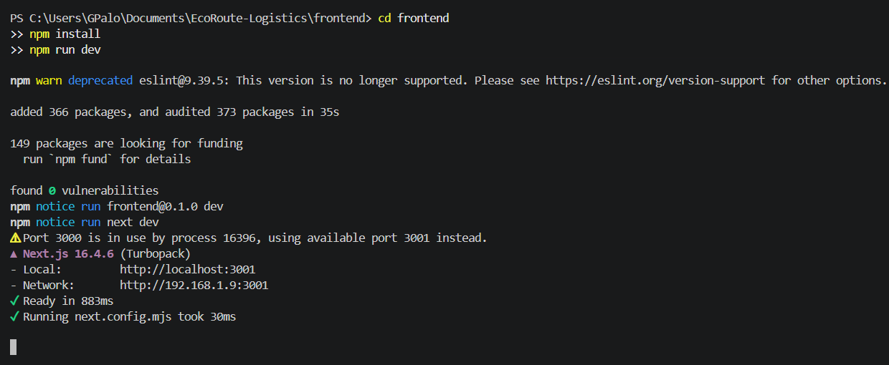
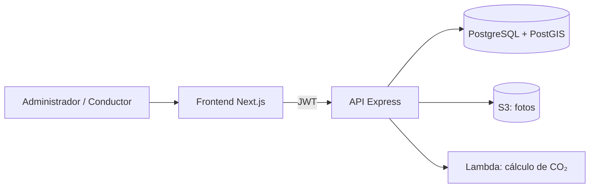

# EcoRoute-Logistics
SaaS para optimizar las rutas de entrega de flotas pequeñas (menos de 15 vehículos). Incluye panel del administrador, portal del conductor y cálculo de CO₂ ahorrado. React, Node.js/Express y PostgreSQL con PostGIS, desplegado en AWS.

Documentación de AWS: [docs/aws.md](docs/aws.md)

## Requisitos previos
- **Node.js** (versión LTS recomendada, por ejemplo v20+ o v22+) y `npm`.
- **PostgreSQL** con extensión **PostGIS** habilitada para el manejo geográfico de rutas y paradas.
- **Git** para clonar el repositorio y gestionar ramas/entregas.

## Variables de entorno
Configura las variables necesarias antes de iniciar el backend y el frontend (usa un archivo `.env` local y no subas credenciales reales al repositorio):

- **Backend (`backend/.env`):**
  - `PORT`: puerto del servidor Express (por ejemplo, `3000`).
  - `DATABASE_URL` o parámetros de conexión (`PGHOST`, `PGPORT`, `PGDATABASE`, `PGUSER`, `PGPASSWORD`): conexión a PostgreSQL/PostGIS.
  - `JWT_SECRET`: clave secreta para firmar y validar tokens de autenticación.
- **Frontend:**
  - `VITE_API_URL` o variable base de la API según la configuración del cliente React para apuntar al backend.

## Getting Started (entorno local)
1. **Clonar el repositorio:**
   ```bash
   git clone https://github.com/EcoRoute-Logistics/EcoRoute-Logistics.git
   cd EcoRoute-Logistics
   ```
   2. **Backend:**
   ```bash
   cd backend
   cp .env.example .env     # completa los valores
   npm install
   npm run dev              # http://localhost:3000
   ```
3. **Frontend:**
   ```bash
   cd frontend
   npm install
   npm run dev
   ```

### Entorno local en ejecución
- **Frontend (Next.js):**
  
- **Backend (API Express):**
  

## Estructura del proyecto
```text
EcoRoute-Logistics/
├── .github/
│   ├── workflows/            # Despliegue del backend (GitHub Actions)
│   └── pull_request_template.md
├── backend/
│   ├── migrations/           # Esquema SQL (PostGIS, vehículos, conductores, pedidos, usuarios)
│   ├── scripts/              # Utilidades, por ejemplo crear usuarios
│   └── src/
│       ├── middleware/       # Verificación de JWT y roles
│       ├── routes/           # Endpoints: auth, vehículos, conductores, archivos, health
│       ├── utils/            # Manejo de errores
│       ├── app.js            # Configuración de Express
│       ├── db.js             # Conexión a PostgreSQL
│       └── server.js         # Punto de entrada (puerto 3000 por defecto)
├── frontend/                 # Panel del administrador y portal del conductor (Next.js)
├── lambda/                   # Función de cálculo de CO₂ (AWS Lambda)
├── docs/
│   ├── api.md                # Contrato de la API
│   ├── aws.md                # Infraestructura y despliegue en AWS
│   └── capturas/             # Capturas de referencia
├── CONTRIBUTING.md
└── README.md
```

## Flujo del sistema
