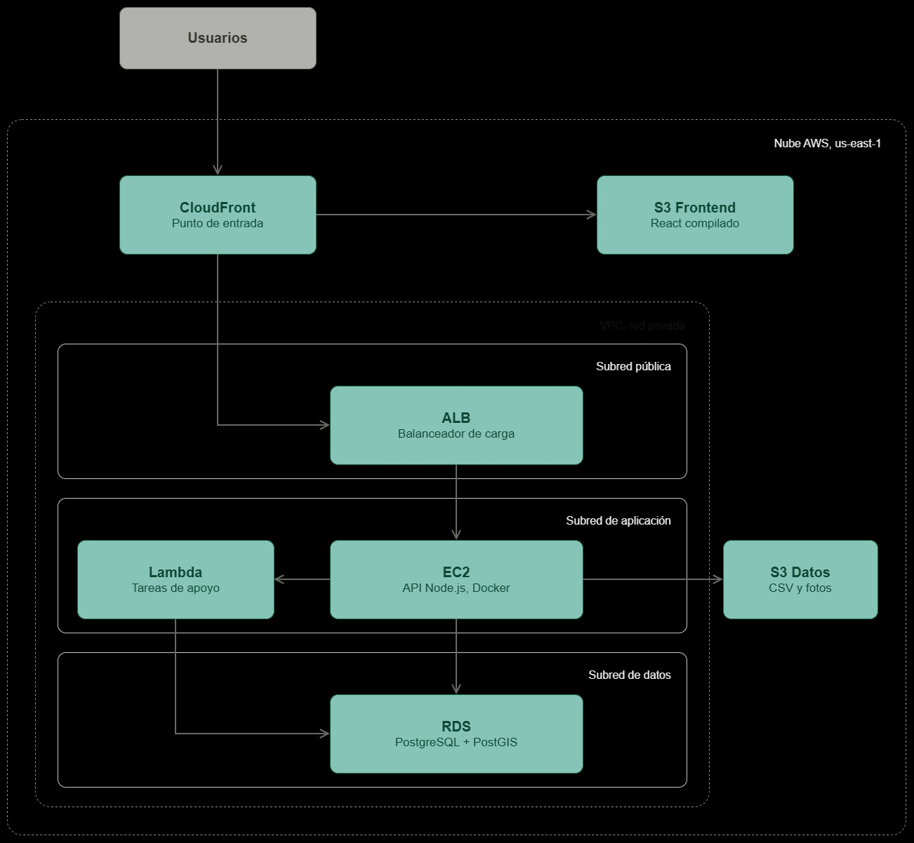
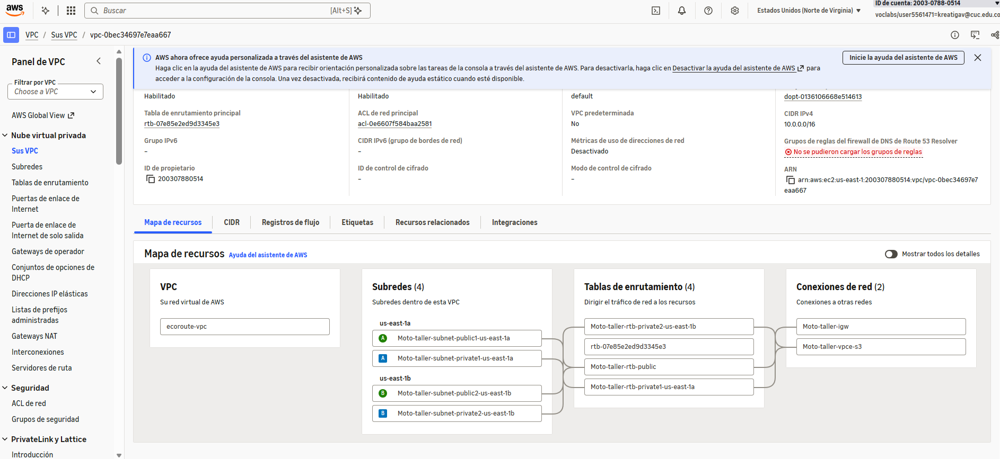
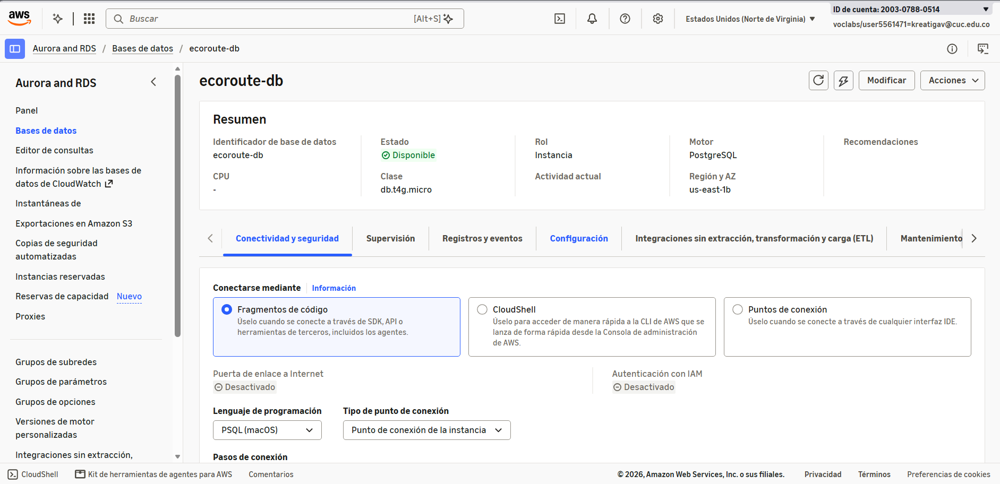
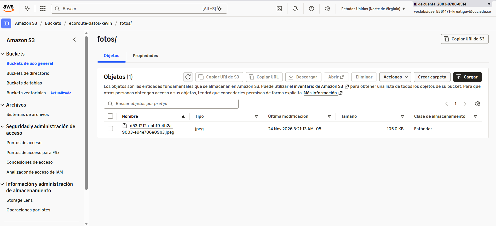
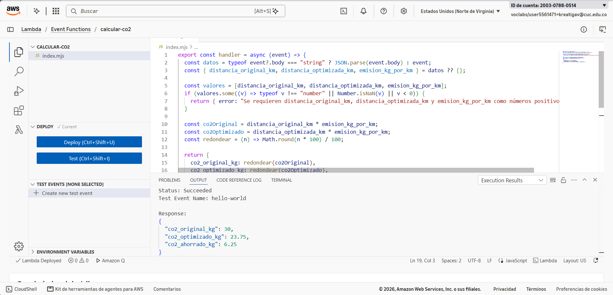

# Arquitectura en AWS

## Estado de los servicios
| Servicio | Para qué sirve | Estado |
|---|---|---|
| VPC (2 subredes públicas, 2 privadas) | Red del proyecto | Creada |
| RDS `ecoroute-db` (PostgreSQL + PostGIS) | Base de datos, sin acceso público | Creada |
| S3 `ecoroute-datos-kevin` | Fotos, firmas y CSV | Creado, subida probada |
| Lambda `calcular-co2` | Calcula el CO₂ ahorrado | Creada y probada |
| EC2, ALB y ECR | API y despliegue | Pendiente |
| CloudFront y dominio | Entrega de la página | Pendiente |

## VPC
Red 10.0.0.0/16 con 2 zonas de disponibilidad, 2 subredes públicas y 2 privadas, sin NAT.

Nota: los recursos de red conservan el prefijo `Moto-taller-` en su nombre, porque se crearon con el asistente de VPC. Es solo un nombre y no afecta el funcionamiento.

## Base de datos (RDS)
PostgreSQL en subred privada, sin acceso público. Las migraciones de `backend/migrations/` se ejecutan en orden (001, 002, 003) desde EC2, porque la base solo es accesible desde dentro de la VPC.

## Almacenamiento (S3)
Bucket privado `ecoroute-datos-kevin`. La API guarda las fotos y firmas en las carpetas `fotos/` y `firmas/`, y entrega enlaces temporales de 5 minutos para verlas.

## Lambda
Función `calcular-co2` (Node.js). Recibe la distancia original, la distancia optimizada y las emisiones del vehículo (kg por km), y devuelve el CO₂ original, el optimizado y el ahorrado. Código en `lambda/calcular-co2/index.mjs`.

## Variables de entorno
Ver `backend/.env.example`. Los valores reales no se suben al repositorio.

## Límites del Learner Lab
Las credenciales cambian en cada sesión y los recursos se pausan al terminarla.